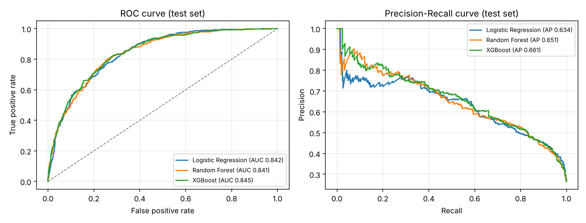
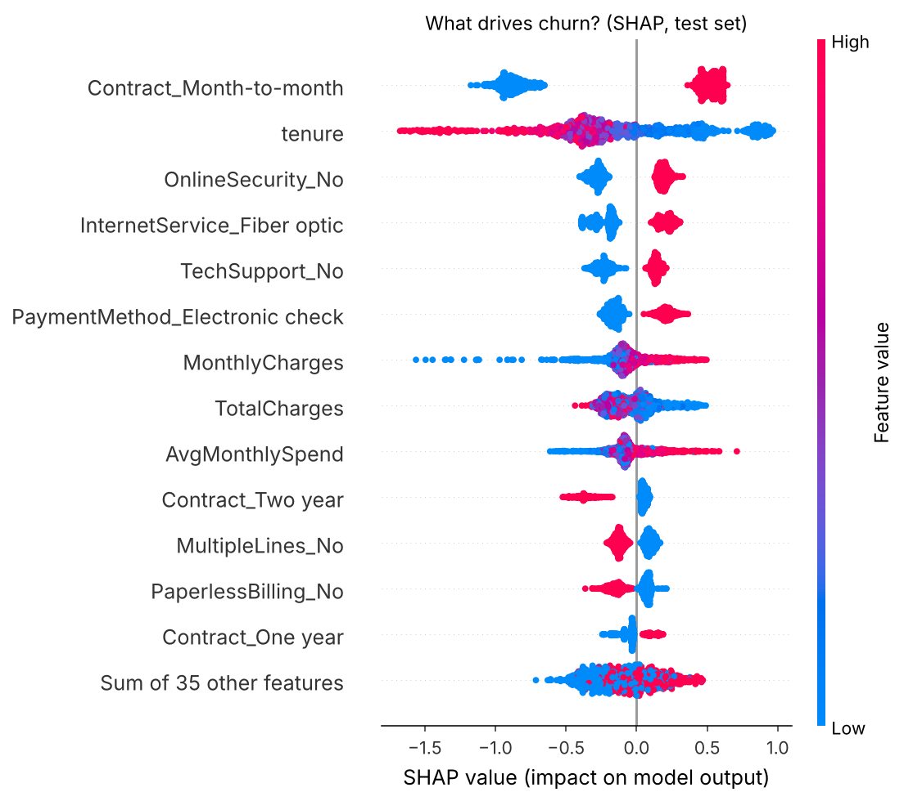
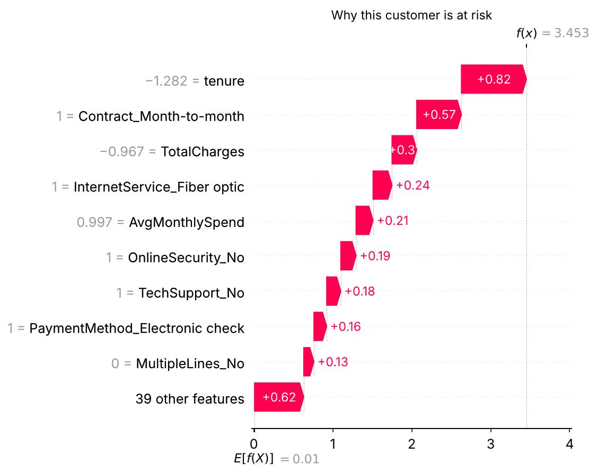

# Customer Churn Prediction with Explainable AI


Predicts which telecom customers are about to leave, **explains why** for every single customer, and picks the decision threshold that **minimises business cost**, not just a textbook metric. Served as a REST API.

## The problem
A subscription business loses revenue every time a customer churns. A retention offer is cheap compared to a lost customer, so the goal is to **catch as many churners as possible at an acceptable offer cost**, and give the retention team a reason they can act on ("no tech support + month-to-month contract"), not just a score.

## Results (held-out test set, 1,409 customers)

| Model | CV ROC-AUC (5-fold) | Test ROC-AUC | Test PR-AUC | Recall @0.5 |
|---|---|---|---|---|
| Logistic Regression | 0.846 ± 0.012 | 0.842 | 0.634 | 0.78 |
| Random Forest | 0.846 ± 0.009 | 0.841 | 0.651 | 0.78 |
| **XGBoost (selected)** | **0.847 ± 0.011** | **0.845** | **0.661** | **0.79** |

**Cost-aware threshold.** Assuming a missed churner costs 12× a retention offer, the threshold is tuned on out-of-fold training predictions (the test set is never used for tuning). At the chosen threshold of **0.15** the model:
- catches **95.7%** of churners (358 of 374),
- cuts the expected cost by **23%** versus the default 0.5 threshold, and by **74%** versus doing nothing.

All numbers are in [`reports/metrics.json`](reports/metrics.json).



## What drives churn?
Global explanation with SHAP: month-to-month contracts, short tenure, no online security / tech support, fiber internet and electronic-check payments push risk up; two-year contracts and long tenure pull it down.



Every prediction also comes with its own explanation:



## How it works
```
raw CSV → cleaning (blank TotalCharges for new customers = 0)
        → domain features (AvgMonthlySpend, ServicesCount)
        → ColumnTransformer (scaling + one-hot)
        → 3 models compared with stratified 5-fold CV
        → best model + cost-optimal threshold (out-of-fold)
        → SHAP TreeExplainer → FastAPI /predict
```

## Data
[IBM Telco Customer Churn](https://github.com/IBM/telco-customer-churn-on-icp4d): 7,043 customers, 26.5% churn rate.

## Source code
The source code is kept private. I'm happy to walk through the implementation, design decisions and results in an interview: [LinkedIn](https://www.linkedin.com/in/mohamed-atef-elsayed) · [Email](mailto:mohamed300atef@gmail.com)

## Author
**Mohamed Atef Elsayed**, AI Engineer · ML Engineer · Data Scientist
[LinkedIn](https://www.linkedin.com/in/mohamed-atef-elsayed) · [Portfolio](https://mohamedatefelsayed.vercel.app)
